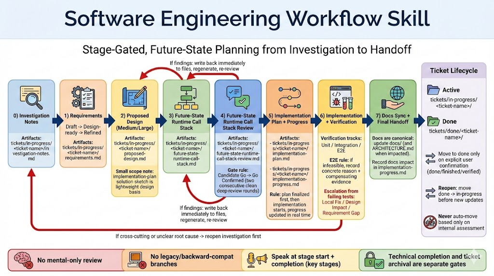
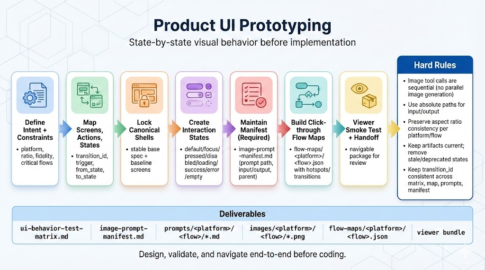
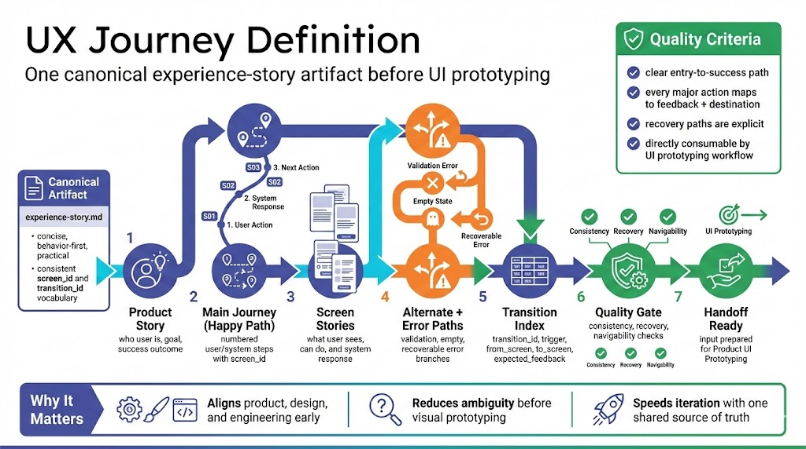

# AutoByteus Skills

This repository contains reusable Codex skills used across AutoByteus projects.

## Skill Infographics

### Software Engineering Workflow Skill

Stage-gated engineering workflow from investigation and requirements to implementation and docs sync.

### LLM Fine-Tuning Skill

Stage-gated LLM fine-tuning workflow centered on durable investigation, implementation planning, implementation plus data preparation, and empirical training/validation evidence.

### Bilingual Author Style Writer

Style-aware workflow for drafting and revising Chinese WeChat and English Medium articles in configurable author voices with profile-based examples.

### Content Management

Write, update and restructure any body of content (articles, documents, living records such as boards and logs, instruction packages, folders of files) so it stays easy to read and find things in as it grows. See [content-management/SKILL.md](content-management/SKILL.md).

### Product UI Prototyping

State-by-state UI behavior prototyping workflow with manifest, flow maps, and viewer handoff.

### UX Journey Definition

One canonical experience-story artifact that defines actions, responses, transitions, and recovery paths.

### Browser Automation

Bash-first skill and CLI for operating a live Chrome/Chromium session (explicit tab IDs, DOM snapshots, JavaScript with a presentation helper, screenshots, MP4 tab recording). Bundle includes a self-provisioning `uv` launcher and a retained thin MCP adapter. See [browser-automation/README.md](browser-automation/README.md).

### Video Audio Editing

Bash-first skill and `video-audio` CLI over ffmpeg for trimming, concatenating, converting, overlaying, subtitling and other video/audio edits, with a retained thin MCP adapter. Requires `ffmpeg` on PATH. See [video-audio-editing/README.md](video-audio-editing/README.md).

## Engineering Guides

- [Argument-Isomorphic MCP-to-CLI Mapping](docs/mcp-to-cli-mapping.md) — rules for converting an MCP capability into a task-oriented CLI plus skill (reference implementation: `browser-automation`).
