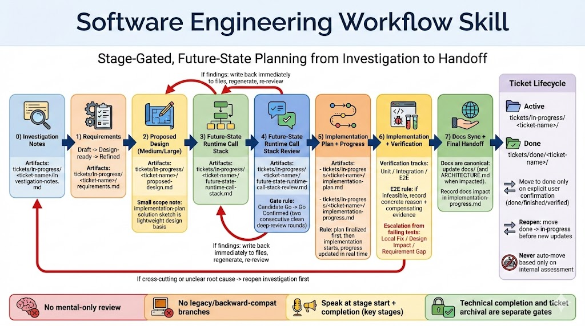
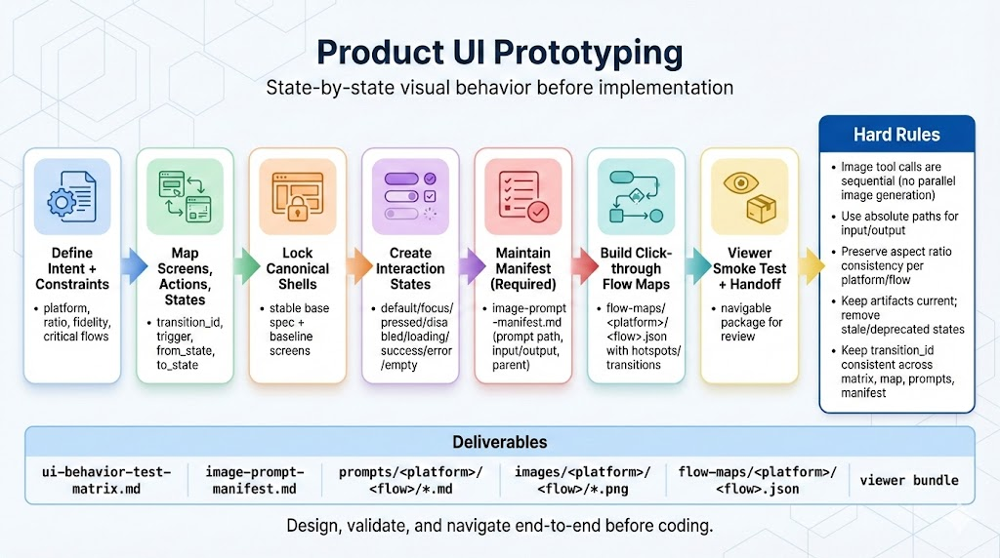
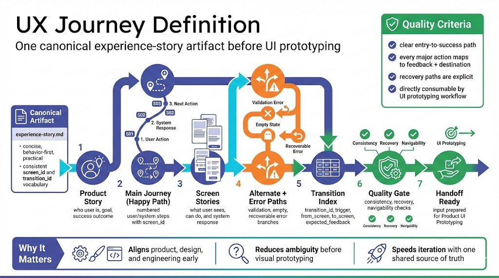

# AutoByteus Skills

This repository contains reusable Codex skills used across AutoByteus projects.

## Skill Infographics

### Software Engineering Workflow Skill

> **Deprecated and frozen (2026-10-25).** This is the older workflow skill: the software engineering team now works from its own role skills, so this skill is no longer updated and does not describe current practice. The current practice lives in the [software engineering team package](https://github.com/AutoByteus/autobyteus-agents/tree/main/agent-teams/software-engineering-team) in `autobyteus-agents`.

Stage-gated engineering workflow from investigation and requirements to implementation and docs sync.

### LLM Fine-Tuning Skill

Stage-gated LLM fine-tuning workflow centered on durable investigation, implementation planning, implementation plus data preparation, and empirical training/validation evidence.

### Bilingual Author Style Writer

Style-aware workflow for drafting and revising Chinese WeChat and English Medium articles in configurable author voices with profile-based examples.

### Content Management

Write, update and restructure any body of content (articles, documents, living records such as boards and logs, instruction packages, folders of files) so it stays easy to read and find things in as it grows. See [content-management/SKILL.md](content-management/SKILL.md).

### Deep Research

Answer a research question in depth from primary sources, for your own work (a post, an article, a deck, a decision) or for a requester: a plan and an evidence file kept as notes, then a sourced brief with dated findings, a check of the claims the work wants to make (`supported`, `not supported`, `needs confirmation`), what was ruled out, and open gaps. Research is kept in the workspace's `research/` folder with one index, so every role in the workspace reuses it. See [deep-research/SKILL.md](deep-research/SKILL.md).

### AutoByteus Sandboxes

Run an agent package in a sandbox: a fresh, disposable AutoByteus node from your node's own release that holds no credentials (its model calls go through your node). Create it with the package and read-only shared folders, prepare inputs in its workspace folder, delegate to its agents, read results and transcripts from the folders on this computer without following links, run checks inside it, and always destroy it. See [autobyteus-sandboxes/SKILL.md](autobyteus-sandboxes/SKILL.md).

### Reflection

Learn from past work, an agent's own or another agent's: after each piece of work a two-question check (what took extra steps, what did the user correct), written as records in a `reflections/` folder in the agent's semantic memory (or workspace), with lessons a later run reads at its start; and a full pass that reads the journals for repeated mistakes and slow routines and proposes skill changes for testing. See [reflection/SKILL.md](reflection/SKILL.md).

### Tailscale Serve Sharing

Share a page or server running on this computer with the user's phone or other devices through Tailscale Serve, tailnet only: read the Serve configuration first, add one entry on a port nobody uses (never 443), remove only that entry, and show that every other entry is unchanged. See [tailscale-serve-sharing/SKILL.md](tailscale-serve-sharing/SKILL.md).

### Product UI Prototyping

State-by-state UI behavior prototyping workflow with manifest, flow maps, and viewer handoff.

### UX Journey Definition

One canonical experience-story artifact that defines actions, responses, transitions, and recovery paths.

### Browser Automation

Bash-first skill and CLI for operating a live Chrome/Chromium session (explicit tab IDs, DOM snapshots, JavaScript with a presentation helper, screenshots, MP4 tab recording). Bundle includes a self-provisioning `uv` launcher and a retained thin MCP adapter. See [browser-automation/README.md](browser-automation/README.md).

### Video Audio Editing

Bash-first skill and `video-audio` CLI over ffmpeg for trimming, concatenating, converting, overlaying, subtitling and other video/audio edits, with a retained thin MCP adapter. Requires `ffmpeg` on PATH. See [video-audio-editing/README.md](video-audio-editing/README.md).

## Engineering Guides

- [Argument-Isomorphic MCP-to-CLI Mapping](docs/mcp-to-cli-mapping.md) — rules for converting an MCP capability into a task-oriented CLI plus skill (reference implementation: `browser-automation`).
